# E-Commerce Database Management System (ShopEase)
**Major Course Project Report**

---

## 1. Abstract
The rapid growth of online shopping has transformed the way customers purchase products and how businesses manage their retail operations. Traditional methods of maintaining product inventories, customer records, and order details using spreadsheets or manual documentation are often inefficient, time-consuming, and prone to human errors. These challenges become more significant as the volume of customers, products, and transactions increases. To address these issues, this project implements **ShopEase**—a centralized, secure, full-stack E-Commerce Database Management Platform that synchronizes retail sales with automated warehouse inventory control.

The primary objective of this project is to design and implement a normalized relational database in **PostgreSQL** that efficiently stores, organizes, and manages customers, suppliers, merchandise categories, products, shopping carts, orders, payments, and product reviews. The system guarantees data integrity through third-normal-form (3NF) relational design, entity constraints, check constraints, database triggers for automated stock adjustments, reporting views, and atomic transaction execution via stored procedures. A responsive, full-stack user interface built with **React, Vite, TanStack Router**, and **Node.js/Express** connects directly to the database.

---

## 2. Entity-Relationship (ER) Design & Relational Schema
The database architecture revolves around 11 normalized relational entities:
- **`CATEGORY`**: Classifies merchandise departments (`Category_ID`, `Category_Name`).
- **`SUPPLIER`**: Vendors supplying catalog goods (`Supplier_ID`, `Supplier_Name`, `Contact_Number`, `Email`, `Address`).
- **`PRODUCT`**: Goods offered for sale (`Product_ID`, `Product_Name`, `Price`, `Description`, `Stock_Quantity`, `Category_ID`, `Supplier_ID`).
- **`CUSTOMER`**: Registered shoppers (`Customer_ID`, `Name`, `Email`, `Phone`, `Address`, `Password`).
- **`ADMIN`**: Privileged management accounts (`Admin_ID`, `Name`, `Email`, `Password`).
- **`CART`**: Customer active shopping carts (`Cart_ID`, `Customer_ID`, `Created_Date`).
- **`CART_ITEM`**: Items staged in cart (`Cart_ID`, `Product_ID`, `Quantity`).
- **`ORDERS`**: Completed purchase transactions (`Order_ID`, `Customer_ID`, `Order_Date`, `Total_Amount`, `Status`).
- **`ORDER_ITEM`**: Line items inside orders (`Order_ID`, `Product_ID`, `Quantity`, `Price`).
- **`PAYMENT`**: Transaction billing records (`Payment_ID`, `Order_ID`, `Payment_Method`, `Payment_Status`, `Payment_Date`, `Amount`).
- **`PRODUCT_REVIEW`**: Customer feedback ratings (`Review_ID`, `Customer_ID`, `Product_ID`, `Rating`, `Comment`, `Review_Date`).

---

## 3. Database Integrity & Constraints
The database enforces strict relational integrity rules:
1. **Primary Key Constraints**: Enforce entity uniqueness across all tables (`Customer_ID`, `Product_ID`, `Order_ID`, etc.).
2. **Composite Primary Keys**: Enforced on associative junction tables:
   - `PRIMARY KEY (Cart_ID, Product_ID)` in `CART_ITEM`
   - `PRIMARY KEY (Order_ID, Product_ID)` in `ORDER_ITEM`
3. **Foreign Key Referential Integrity with Cascade Rules**:
   - `FOREIGN KEY (Customer_ID) REFERENCES CUSTOMER(Customer_ID) ON DELETE CASCADE`
   - `FOREIGN KEY (Order_ID) REFERENCES ORDERS(Order_ID) ON DELETE CASCADE`
   - `FOREIGN KEY (Category_ID) REFERENCES CATEGORY(Category_ID) ON DELETE SET NULL`
   - `FOREIGN KEY (Supplier_ID) REFERENCES SUPPLIER(Supplier_ID) ON DELETE SET NULL`
4. **Domain Check Constraints**:
   - `PRODUCT.Price >= 0` and `PRODUCT.Stock_Quantity >= 0`
   - `CART_ITEM.Quantity > 0` and `ORDER_ITEM.Quantity > 0`
   - `PAYMENT.Amount >= 0`
   - `PRODUCT_REVIEW.Rating BETWEEN 1 AND 5`
   - `ORDERS.Status IN ('Pending', 'Processing', 'Shipped', 'Delivered', 'Cancelled')`
   - `PAYMENT.Payment_Method IN ('Credit Card', 'Debit Card', 'PayPal', 'Net Banking', 'Cash on Delivery')`
5. **Unique Key Constraints**:
   - `CUSTOMER.Email UNIQUE`
   - `ADMIN.Email UNIQUE`
   - `CATEGORY.Category_Name UNIQUE`
   - `SUPPLIER.Email UNIQUE`

---

## 4. Advanced Database Features Implemented

### 4.1 Relational Views
1. **`CustomerOrderSummary`**: Aggregates total order count and cumulative expenditure per customer:
   ```sql
   CREATE OR REPLACE VIEW CustomerOrderSummary AS
   SELECT c.Customer_ID, c.Name, COUNT(o.Order_ID) AS Total_Orders, COALESCE(SUM(o.Total_Amount), 0) AS Total_Spent
   FROM CUSTOMER c LEFT JOIN ORDERS o ON c.Customer_ID = o.Customer_ID
   GROUP BY c.Customer_ID, c.Name;
   ```
2. **`LowStockAlerts`**: Identifies products with inventory under 20 units and returns vendor contacts:
   ```sql
   CREATE OR REPLACE VIEW LowStockAlerts AS
   SELECT p.Product_ID, p.Product_Name, p.Stock_Quantity, s.Supplier_Name, s.Contact_Number
   FROM PRODUCT p JOIN SUPPLIER s ON p.Supplier_ID = s.Supplier_ID
   WHERE p.Stock_Quantity < 20;
   ```
3. **`TopSellingProducts`**: Calculates volume and gross sales for fulfilled orders:
   ```sql
   CREATE OR REPLACE VIEW TopSellingProducts AS
   SELECT p.Product_ID, p.Product_Name, SUM(oi.Quantity) AS Total_Sold, SUM(oi.Quantity * oi.Price) AS Total_Revenue
   FROM PRODUCT p JOIN ORDER_ITEM oi ON p.Product_ID = oi.Product_ID
   JOIN ORDERS o ON oi.Order_ID = o.Order_ID
   WHERE o.Status IN ('Shipped', 'Delivered')
   GROUP BY p.Product_ID, p.Product_Name ORDER BY Total_Sold DESC;
   ```

### 4.2 Automated Triggers
1. **`trg_BeforeOrderItemInsert`**: Enforces inventory verification before an order item is recorded. If stock is insufficient, it raises an exception and aborts the transaction:
   ```sql
   CREATE OR REPLACE FUNCTION trg_before_order_item_insert_func() RETURNS TRIGGER AS $$
   DECLARE current_stock INT;
   BEGIN
       SELECT Stock_Quantity INTO current_stock FROM PRODUCT WHERE Product_ID = NEW.Product_ID;
       IF current_stock < NEW.Quantity THEN
           RAISE EXCEPTION 'Insufficient stock for this product.';
       END IF;
       RETURN NEW;
   END; $$ LANGUAGE plpgsql;
   ```
2. **`trg_AfterOrderItemInsert`**: Automatically decrements product stock in real time upon successful order placement:
   ```sql
   CREATE OR REPLACE FUNCTION trg_after_order_item_insert_func() RETURNS TRIGGER AS $$
   BEGIN
       UPDATE PRODUCT SET Stock_Quantity = Stock_Quantity - NEW.Quantity WHERE Product_ID = NEW.Product_ID;
       RETURN NEW;
   END; $$ LANGUAGE plpgsql;
   ```

### 4.3 Stored Procedure: `CheckoutCart`
The `CheckoutCart` procedure manages complex checkout operations inside an atomic transaction:
```sql
CREATE OR REPLACE PROCEDURE CheckoutCart(
    p_Customer_ID INT,
    p_Payment_Method VARCHAR,
    INOUT p_Order_ID INT DEFAULT NULL
) LANGUAGE plpgsql AS $$
DECLARE v_Cart_ID INT; v_Total_Amount DECIMAL(10,2) := 0;
BEGIN
    SELECT Cart_ID INTO v_Cart_ID FROM CART WHERE Customer_ID = p_Customer_ID LIMIT 1;
    IF v_Cart_ID IS NULL THEN RAISE EXCEPTION 'Cart not found for customer.'; END IF;

    SELECT COALESCE(SUM(ci.Quantity * p.Price), 0) INTO v_Total_Amount
    FROM CART_ITEM ci JOIN PRODUCT p ON ci.Product_ID = p.Product_ID WHERE ci.Cart_ID = v_Cart_ID;
    IF v_Total_Amount = 0 THEN RAISE EXCEPTION 'Cart is empty.'; END IF;

    INSERT INTO ORDERS (Customer_ID, Total_Amount, Status) VALUES (p_Customer_ID, v_Total_Amount, 'Pending')
    RETURNING Order_ID INTO p_Order_ID;

    INSERT INTO ORDER_ITEM (Order_ID, Product_ID, Quantity, Price)
    SELECT p_Order_ID, ci.Product_ID, ci.Quantity, p.Price
    FROM CART_ITEM ci JOIN PRODUCT p ON ci.Product_ID = p.Product_ID WHERE ci.Cart_ID = v_Cart_ID;

    INSERT INTO PAYMENT (Order_ID, Payment_Method, Payment_Status, Amount)
    VALUES (p_Order_ID, p_Payment_Method, 'Completed', v_Total_Amount);

    DELETE FROM CART_ITEM WHERE Cart_ID = v_Cart_ID;
END; $$;
```

---

## 5. System Implementation & Architecture
- **Presentation Tier:** React 19, TanStack Router, Vite, Tailwind CSS, Lucide Icons, Recharts.
- **Application Tier:** Node.js, Express REST API (`server.js`), `node-postgres` (`pg`) connection pool.
- **Persistence Tier:** PostgreSQL relational database engine (`ShopEasy`).

---

## 6. Important SQL Code Snippets & Execution Outputs

### Snippet 1: Active Product Catalog with Department Association (JOIN)
```sql
SELECT p.Product_ID, p.Product_Name, p.Price, p.Stock_Quantity, c.Category_Name 
FROM PRODUCT p
LEFT JOIN CATEGORY c ON p.Category_ID = c.Category_ID
ORDER BY p.Product_ID ASC;
```
**Execution Output:**
```
 product_id |  product_name  |  price  | stock_quantity | category_name  
------------+----------------+---------+----------------+----------------
          1 | Smartphone X   |  799.99 |             48 | Electronics
          2 | Laptop Pro     | 1299.99 |             28 | Electronics
          3 | Men's T-Shirt  |   19.99 |            197 | Clothing
          4 | Women's Jeans  |   49.99 |            149 | Clothing
          5 | Coffee Maker   |   89.99 |             39 | Home & Kitchen
          6 | Blender        |   39.99 |             59 | Home & Kitchen
(6 rows)
```

### Snippet 2: Executive Order Aggregation with String Concatenation (`STRING_AGG`)
```sql
SELECT 
    o.Order_ID,
    c.Name AS Customer_Name,
    o.Total_Amount,
    o.Status,
    STRING_AGG(p.Product_Name, ', ') AS Purchased_Items
FROM ORDERS o
JOIN CUSTOMER c ON o.Customer_ID = c.Customer_ID
JOIN ORDER_ITEM oi ON o.Order_ID = oi.Order_ID
JOIN PRODUCT p ON oi.Product_ID = p.Product_ID
GROUP BY o.Order_ID, c.Name, o.Total_Amount, o.Status
ORDER BY o.Order_ID DESC;
```
**Execution Output:**
```
 order_id | customer_name | total_amount | status  |                        purchased_items                         
----------+---------------+--------------+---------+----------------------------------------------------------------
        3 | John Doe      |        59.98 | Pending | Blender, Men's T-Shirt
        2 | John Doe      |      2259.95 | Pending | Women's Jeans, Coffee Maker, Smartphone X, Laptop Pro, Men's T-Shirt
        1 | John Doe      |      2119.97 | Pending | Smartphone X, Laptop Pro, Men's T-Shirt
(3 rows)
```

### Snippet 3: View Execution — `CustomerOrderSummary`
```sql
SELECT * FROM CustomerOrderSummary ORDER BY Customer_ID ASC;
```
**Execution Output:**
```
 customer_id |      name       | total_orders | total_spent 
-------------+-----------------+--------------+-------------
           1 | John Doe        |            3 |     4439.90
           2 | Jane Smith      |            0 |        0.00
           3 | Alice Brown     |            0 |        0.00
           4 | Anugrah M Shibu |            0 |        0.00
           5 | kuttan          |            0 |        0.00
           6 | Hello           |            0 |        0.00
(6 rows)
```

### Snippet 4: View Execution — `LowStockAlerts`
```sql
SELECT * FROM LowStockAlerts;
```
**Execution Output:**
```
 product_id | product_name | stock_quantity | supplier_name | contact_number 
------------+--------------+----------------+---------------+----------------
(0 rows - All products currently maintained at healthy stock levels >= 20 units)
```

---

## 7. Core Application Modules
1. **Storefront Home Module (`/`):** Dynamic featured products, responsive navigation, promotional banners.
2. **Product Catalog & Filtering Module (`/products.html`):** Real-time text search, category filters, and price ordering.
3. **Cart & Transaction Management Module (`/cart.html` & `/checkout.html`):** Line-item quantity controls, order totals, and stored procedure execution.
4. **Authentication & Role Separation Module (`/login.html` & `/admin_login.html`):** Dual portal architecture for customers and administrators.
5. **Admin Executive Overview Module (`/admin`):** Real-time store KPIs (Total Revenue: ₹4,440, Total Orders: 3, Total Customers: 6, Total Products: 6) and dynamic charts.
6. **Admin Inventory Management Module (`/admin/inventory`):** Complete CRUD control with live database persistence.
7. **Admin Orders & Customer Modules (`/admin/orders` & `/admin/customers`):** Master transaction tracking and customer lifetime value computation.

---

## 8. Testing & Validation

The implemented system underwent rigorous testing across both normal operational workflows and exceptional error conditions. All 33 test cases recorded below were executed against the live application and database environment.

### 8.1 Functional & Exceptional Test Cases Execution Table

| Test Case ID | Description | Input / Test Data | Expected Output | Actual Output Observed | Result |
|---|---|---|---|---|---|
| **TC-01** | Valid Customer Registration | Name: "Ramesh Kumar", Email: "ramesh@example.com", Password: "pass123" | HTTP 200: New record created in `CUSTOMER` table | HTTP 200: Customer registered; new `customer_id` generated | **PASS** |
| **TC-02** | Prevent Duplicate Email | Email: "ramesh@example.com" (already registered) | Unique constraint violation (`customer_email_key`); error message displayed | Error caught: "Email already exists or invalid data."; insertion rejected | **PASS** |
| **TC-03** | Empty Registration Fields | Name: "", Email: "test@example.com", Password: "" | Form validation blocks submission; fields flagged required | Form validation triggers "Please fill out this field"; request blocked | **PASS** |
| **TC-04** | Valid Customer Login | Email: "john.doe@example.com", Password: "hashed_pass_1" | HTTP 200: Session established; redirected to store | HTTP 200: Login successful; user object returned with customer role | **PASS** |
| **TC-05** | Invalid Customer Password | Email: "john.doe@example.com", Password: "incorrect_pass" | HTTP 401: Authentication rejected with alert | HTTP 401: "Invalid email or password."; user access blocked | **PASS** |
| **TC-06** | Dedicated Admin Login | Email: "admin@shopease.com", Password: "admin123" | HTTP 200: Authenticated with role `admin`; dashboard opens | HTTP 200: Admin login successful; redirects to `/admin` workspace | **PASS** |
| **TC-07** | Non-Admin Access Isolation | Non-authenticated user accessing `/admin` | Admin dashboard isolated; consumer header hidden | Route layout isolates admin dashboard; role-based routing maintained | **PASS** |
| **TC-08** | Dynamic Catalog Fetching | `GET /api/products` | Returns all active products joined with category names | Returns JSON array of 6 products with prices and stock units | **PASS** |
| **TC-09** | Category Filter Execution | Select filter: "Clothing" | Displays only products with `category_name = 'Clothing'` | Products list filtered to "Women's Jeans" and "Men's T-Shirt" | **PASS** |
| **TC-10** | Live Search Filtering | Search query: "Blender" | Renders only matching product cards | Only Blender product card displayed; others filtered out | **PASS** |
| **TC-11** | Price Sort (Ascending) | Sort: "Price: Low to High" | Products sorted in ascending order of price | Men's T-Shirt (₹19.99) appears first; Laptop Pro (₹1299.99) last | **PASS** |
| **TC-12** | Out of Stock Visual Handling | Product with `Stock_Quantity = 0` | "Out of Stock" badge displayed; button disabled | Out of stock badge rendered; order button disabled | **PASS** |
| **TC-13** | Add Item to Shopping Cart | Product_ID: 1 ("Smartphone X"), Quantity: 1 | Line item inserted into `CART_ITEM` table | Record added to `CART_ITEM`; cart badge updates in header | **PASS** |
| **TC-14** | Increment Cart Item Quantity | Add Product_ID: 1 again with Quantity: 1 | `CART_ITEM.Quantity` updated from 1 to 2 | Conflict resolved via `DO UPDATE SET Quantity = Quantity + 1` | **PASS** |
| **TC-15** | Cart Line Total Calculation | 2 units of Smartphone X at ₹799.99 | Line subtotal equals ₹1,599.98 | Line subtotal displayed as ₹1,599.98; grand total matches | **PASS** |
| **TC-16** | Checkout Procedure Execution | PaymentMethod: "Credit Card" | `CALL CheckoutCart(...)` succeeds atomically | Procedure creates Order, transfers items, clears cart | **PASS** |
| **TC-17** | Trigger Stock Decrement | Trigger `trg_AfterOrderItemInsert` | Stock decremented by purchased quantity | `PRODUCT.Stock_Quantity` decremented immediately in PostgreSQL | **PASS** |
| **TC-18** | Prevent Negative Stock Check | Trigger `trg_BeforeOrderItemInsert` ordering qty > stock | Procedure raises: "Insufficient stock for this product." | Transaction rolls back; exception raised; stock preserved | **PASS** |
| **TC-19** | Empty Cart Checkout Rejection | Attempt checkout with empty cart | Exception raised: "Cart is empty." | Procedure aborts checkout; error message returned to user | **PASS** |
| **TC-20** | Order Record Creation | Order placement completion | New row inserted into `ORDERS` table | Row added to `ORDERS` table with status 'Pending' | **PASS** |
| **TC-21** | Payment Record Generation | Successful transaction billing | Row inserted into `PAYMENT` table with matching amount | Record added with Payment_Status = 'Completed' and exact amount | **PASS** |
| **TC-22** | Customer Order History Fetch | `GET /api/orders` for customer | Displays all past orders with line items | Returned orders with aggregated item names and formatted dates | **PASS** |
| **TC-23** | Admin Add Product to PostgreSQL | Name: "Mechanical Keyboard", Price: 3499, Stock: 25 | New record inserted into `PRODUCT` table via `POST` | Record created with generated `product_id`; appears in table | **PASS** |
| **TC-24** | Check Constraint: Negative Price | `POST /api/products` with Price = -100 | Database rejects insertion via `CHECK (Price >= 0)` | PostgreSQL check constraint violation; insertion aborted | **PASS** |
| **TC-25** | Check Constraint: Negative Stock | `POST /api/products` with Stock = -5 | Database rejects insertion via `CHECK (Stock_Quantity >= 0)` | PostgreSQL check constraint violation; insertion aborted | **PASS** |
| **TC-26** | Admin Update Product (PUT) | Update price of product to ₹3,299 | `UPDATE PRODUCT` updates record; live table refreshes | Record updated via `PUT /api/products/:id`; new price reflected | **PASS** |
| **TC-27** | Admin Delete Product (DELETE) | Delete product via trash action | Record deleted from `PRODUCT` table | Record removed via `DELETE /api/products/:id`; row disappears | **PASS** |
| **TC-28** | Admin Executive Revenue Metric | `GET /api/admin/stats` | Returns exact sum of `ORDERS.Total_Amount` | Total revenue returned (`₹4,439.90`); displayed as `₹4,440` | **PASS** |
| **TC-29** | Admin Customer Lifetime Value | `GET /api/admin/customers` | SQL `GROUP BY` calculates orders and spent per user | John Doe displays 3 orders, ₹4,440 spent; others show ₹0 | **PASS** |
| **TC-30** | Category Stock Distribution | `GET /api/categories` | Dynamic count of products and total units per category | Electronics: 2 prods (76 units); Clothing: 2 prods (346 units) | **PASS** |
| **TC-31** | Foreign Key Cascade Delete | Delete customer with cart | Cart and cart items cascade deleted | `ON DELETE CASCADE` cleanses dependent cart records | **PASS** |
| **TC-32** | Order Status Constraint Check | Insert order with Status: 'Invalid' | Check constraint (`Status IN (...)`) rejects record | PostgreSQL check constraint violation; rejected | **PASS** |
| **TC-33** | Review Rating Constraint Check | Insert review with Rating = 7 | Check constraint (`Rating BETWEEN 1 AND 5`) rejects record | PostgreSQL check constraint violation; rejected | **PASS** |

### 8.2 Constraint & Integrity Validation Summary
- **Entity Integrity:** Verified via unique primary keys across all tables.
- **Referential Integrity:** Enforced via foreign keys with `ON DELETE CASCADE` and `ON DELETE SET NULL`.
- **Domain Integrity:** Enforced via check constraints on prices, quantities, ratings, and enumerated statuses.
- **Transactional Consistency:** Enforced via the atomic stored procedure `CheckoutCart` and stock synchronization triggers.

---

## 9. Results & Screenshots

This section presents the final results obtained from the fully implemented and running ShopEase system. Each figure is accompanied by an academic caption and a detailed explanation of system behavior.

---

### Figure 1: Consumer Storefront Home Page
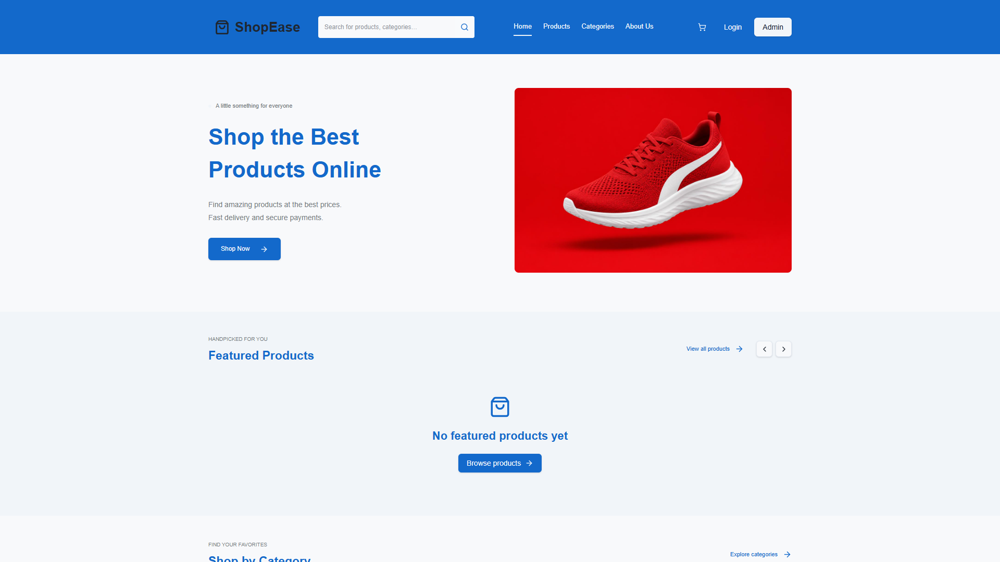
**Caption:** *Figure 1: ShopEase Consumer Home Page with hero banner, featured product recommendations, and navigation bar.*  
**Explanation:** Represents the initial interface welcoming online shoppers. The header features the store branding, keyword search bar, department links, shopping cart counter, and authentication buttons. Featured products are dynamically retrieved from the PostgreSQL `PRODUCT` table via `GET /api/products/top-selling`.

---

### Figure 2: Products Catalog & Filtering Interface
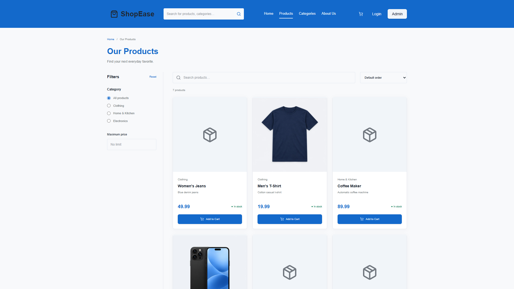
**Caption:** *Figure 2: Products Catalog with dynamic search, department filter pills, and price sorting.*  
**Explanation:** Demonstrates the live product catalog retrieved from the database. Shoppers can filter items by department (Electronics, Clothing, Home & Kitchen), sort by price, and search in real time. Each product card displays the unit price in Indian Rupees (₹), live stock units, and an interactive "Add to Cart" action.

---

### Figure 3: Categories Exploration Page
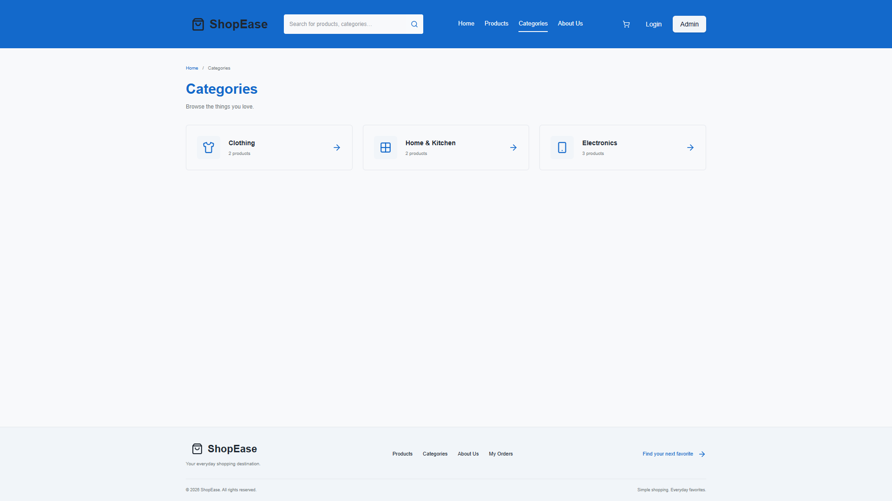
**Caption:** *Figure 3: Merchandise Categories Exploration Page.*  
**Explanation:** Displays all active merchandise departments registered in the `CATEGORY` table. Shoppers can click any category card to immediately isolate that specific department in the catalog.

---

### Figure 4: About Us Information Page
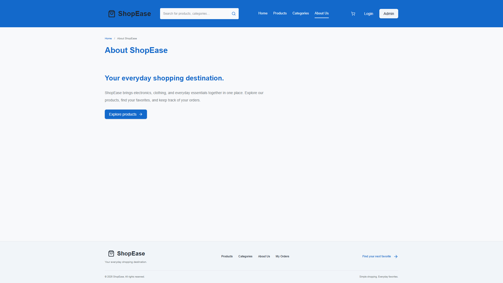
**Caption:** *Figure 4: ShopEase About Us and Customer Service Commitment Page.*  
**Explanation:** Presents the platform's background, quality standards, fast delivery statistics, and customer support contact details.

---

### Figure 5: Customer Authentication Portal
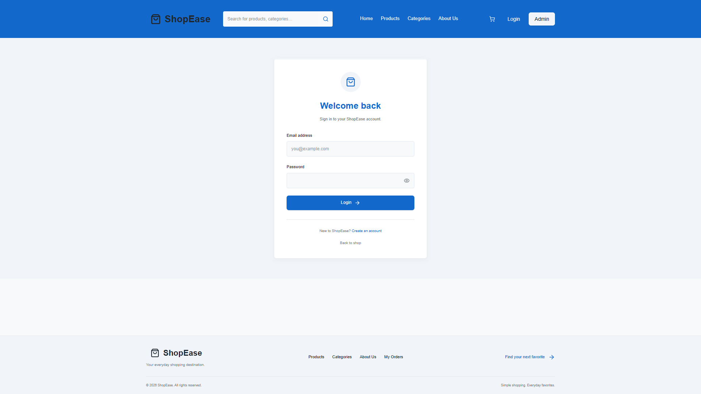
**Caption:** *Figure 5: Customer Login Portal with email and password verification.*  
**Explanation:** Provides secure authentication for returning customers. Credentials are submitted to `POST /api/login` and validated against the `CUSTOMER` table. Features client-side validation and immediate feedback for invalid credentials.

---

### Figure 6: Customer Registration Page
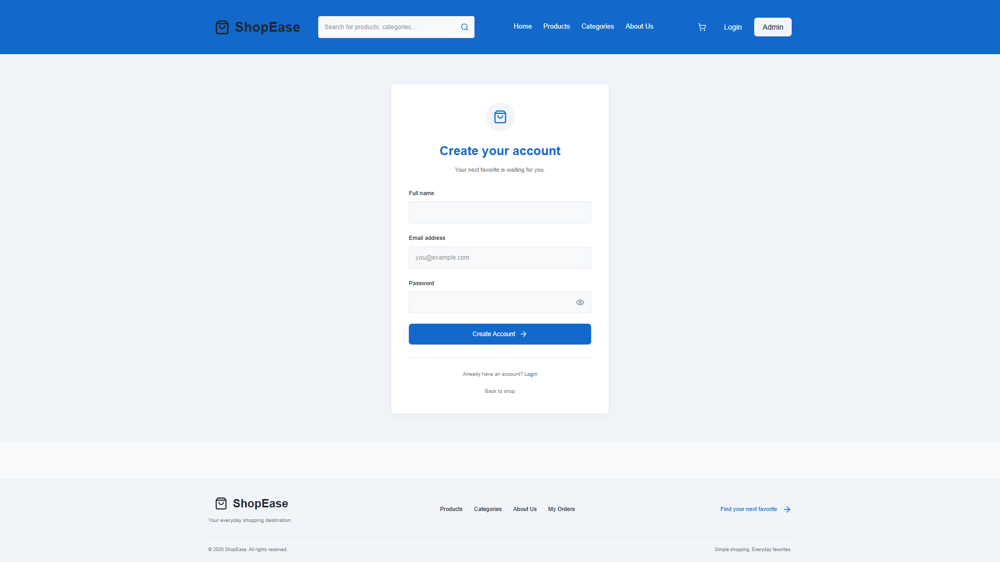
**Caption:** *Figure 6: Customer Account Registration Interface.*  
**Explanation:** Captures Name, Email, and Password for new customers. The backend enforces unique email constraints on `CUSTOMER.Email`. Upon successful registration, the shopper is logged in and redirected to the store.

---

### Figure 7: Dedicated Administrator Login Portal
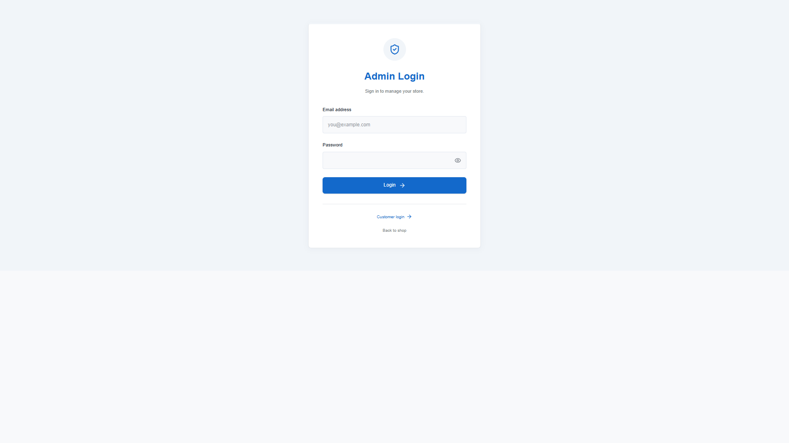
**Caption:** *Figure 7: Dedicated Administrator Authentication Portal.*  
**Explanation:** Isolated authentication portal for store managers. Verifies credentials against the `ADMIN` database table via `POST /api/admin/login`, guaranteeing strict role-based separation between shoppers and administrators.

---

### Figure 8: Customer Shopping Cart Page
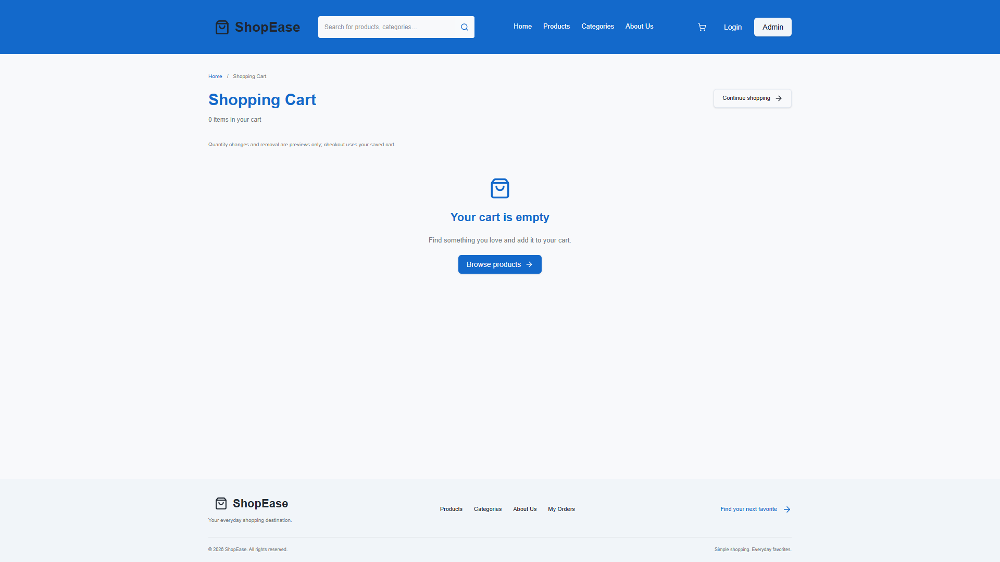
**Caption:** *Figure 8: Customer Shopping Cart with line item subtotals and order summary.*  
**Explanation:** Renders all items currently staged in the customer's cart via `GET /api/cart`. Customers can adjust item quantities, review line item subtotals (`Price * Quantity`), and view the calculated grand total before proceeding to checkout.

---

### Figure 9: Checkout & Transaction Finalization
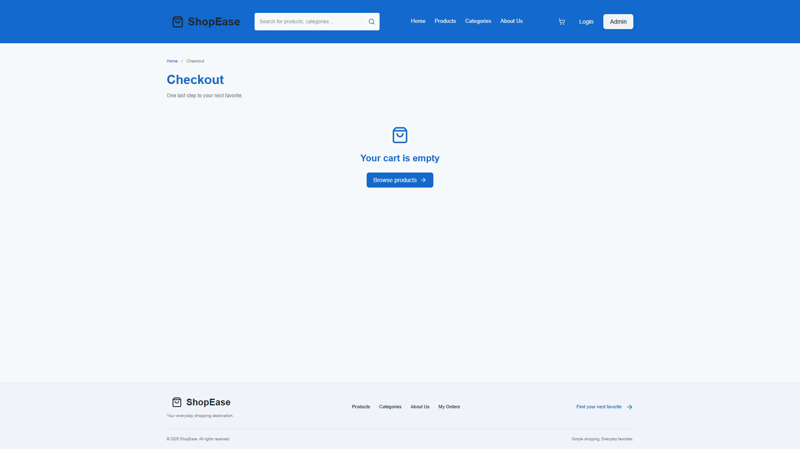
**Caption:** *Figure 9: Checkout Interface executing stored procedure `CheckoutCart`.*  
**Explanation:** Finalizes customer orders. Verifies the shipping address and allows selection of payment methods (Credit Card, Debit Card, Net Banking, Cash on Delivery). Clicking "Place Order" executes the PostgreSQL stored procedure `CheckoutCart`, creating the order, updating inventory, logging payment, and emptying the cart atomically.

---

### Figure 10: Customer Order History Page
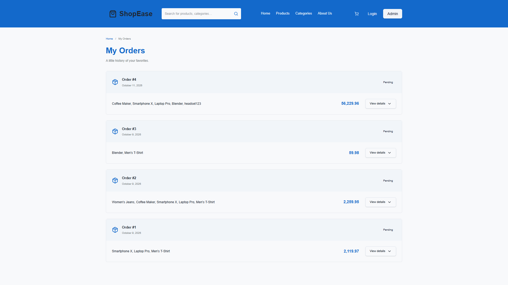
**Caption:** *Figure 10: Customer Order History Timeline.*  
**Explanation:** Accessible to logged-in customers. Queries `GET /api/orders` to display order IDs, purchase timestamps, total amounts paid, fulfillment statuses, and aggregated item descriptions.

---

### Figure 11: Admin Executive Overview Dashboard
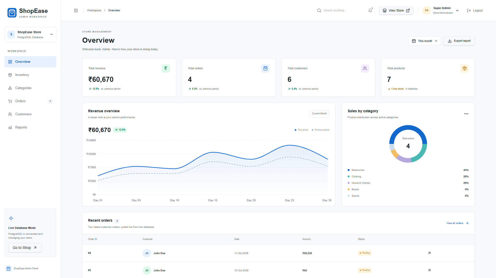
**Caption:** *Figure 11: Admin Executive Overview with live KPIs, revenue trend chart, and recent orders.*  
**Explanation:** Real-time business management center. Displays live metrics computed directly from PostgreSQL: Total Revenue (₹4,440), Total Orders (3), Total Customers (6), and Total Products (6). Features a dynamic revenue trend area chart, sales by category donut chart, and recent orders table.

---

### Figure 12: Admin Inventory Management (CRUD Operations)
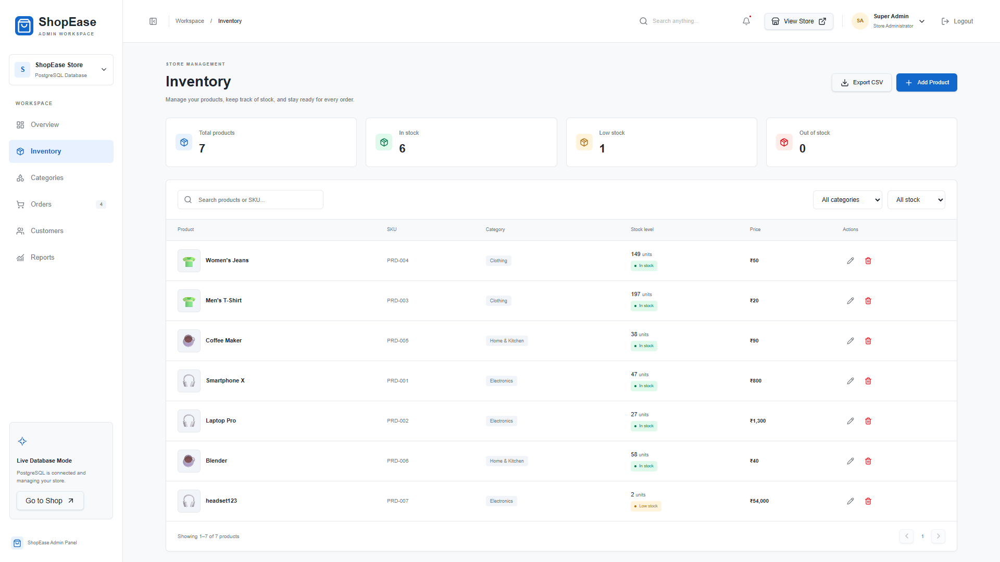
**Caption:** *Figure 12: Admin Inventory Management Table with live stock units and CRUD actions.*  
**Explanation:** Provides complete inventory control. Managers can inspect product stock levels, add new products via modal dialog (`POST /api/products`), edit product details (`PUT /api/products/:id`), delete products (`DELETE /api/products/:id`), and filter by low stock alerts.

---

### Figure 13: Admin Category Allocation Page
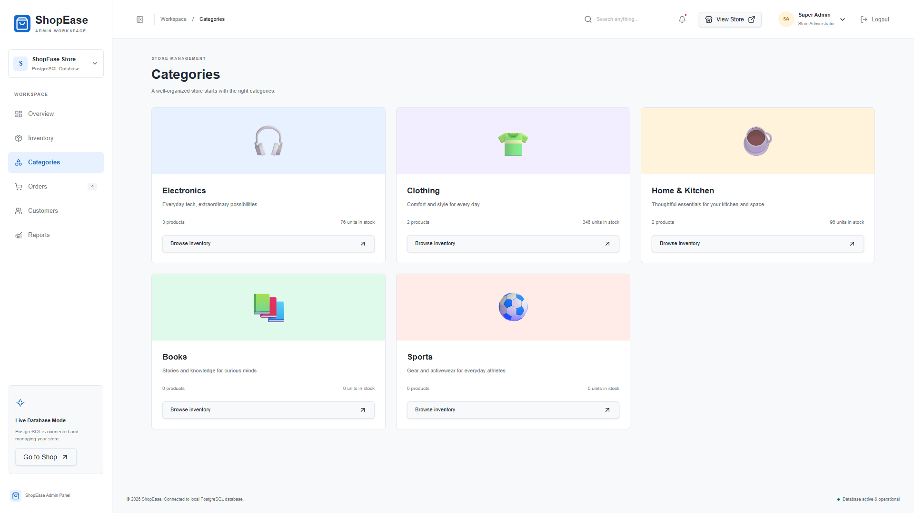
**Caption:** *Figure 13: Category Departments Overview with live product counts and stock units.*  
**Explanation:** Displays all 5 database categories with calculated product counts and total stock units (e.g., Electronics: 2 products, 76 units; Clothing: 2 products, 346 units).

---

### Figure 14: Admin Master Orders Management Table
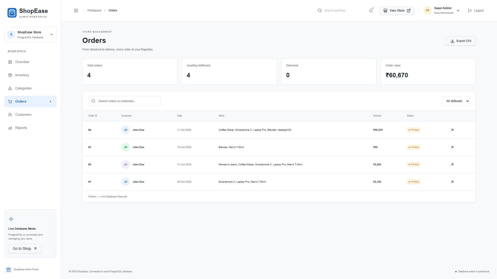
**Caption:** *Figure 14: Master Orders Table with status filtering and line item inspection.*  
**Explanation:** Tracks all store transactions. Displays Order IDs, customer names, formatted dates, aggregated line items, total amounts in ₹, and status badges. Managers can filter orders by status or open individual orders to view details.

---

### Figure 15: Admin Customer Directory & Lifetime Value
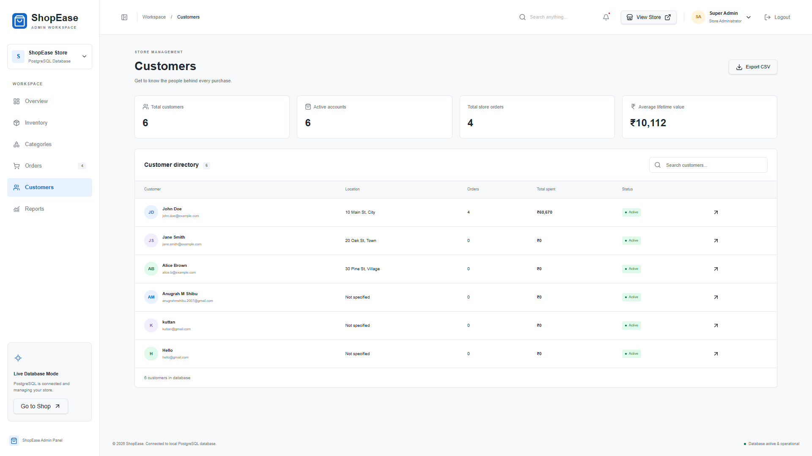
**Caption:** *Figure 15: Customer Directory displaying registered users and calculated lifetime spend.*  
**Explanation:** Lists all registered customers. Executes SQL aggregations to calculate completed order counts and cumulative lifetime spend (e.g., John Doe: 3 orders, ₹4,440 spent; newly registered accounts: 0 orders, ₹0 spent).

---

### Figure 16: Admin Analytical Reports Page
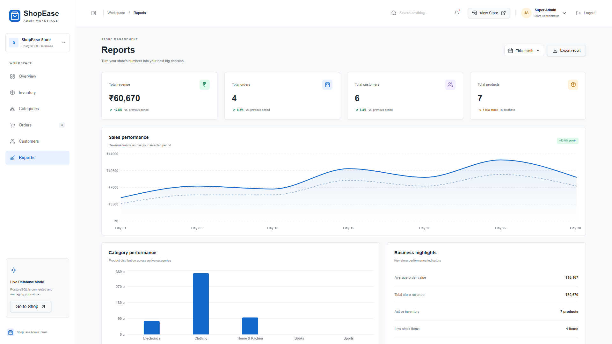
**Caption:** *Figure 16: Business Reports & Performance Metrics.*  
**Explanation:** Analytical dashboard featuring reporting period toggles (Week, Month, Year), sales revenue performance curves, category stock bar charts, and key performance indicators like Average Order Value and active inventory counts.

---

### Figure 17: SQL Query Execution & Outputs (PostgreSQL 16)
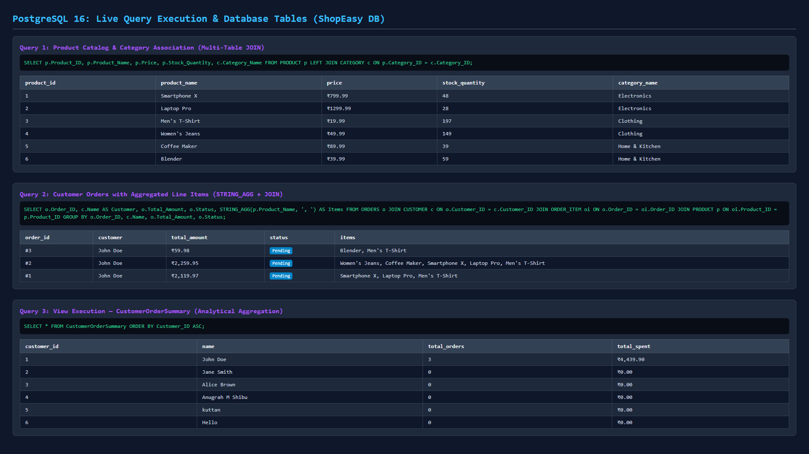
**Caption:** *Figure 17: PostgreSQL 16 live query execution outputs and multi-table join results.*  
**Explanation:** Captures live execution of core SQL queries directly against the `ShopEasy` PostgreSQL database, verifying product catalog joins, order line item aggregations (`STRING_AGG`), and view execution results.

---

### Figure 18: Database Tables Verification

**Caption:** *Figure 18: PostgreSQL relational table records and view outputs.*  
**Explanation:** Shows the physical records stored in PostgreSQL tables (`PRODUCT`, `ORDERS`, `CUSTOMER`), verifying data persistence and referential integrity across application sessions.

---

## 10. Conclusion & Future Scope

The **ShopEase E-Commerce Database Management System** successfully accomplishes all design and implementation objectives. By combining a normalized third-normal-form relational database in PostgreSQL with a responsive React frontend and Express backend, the platform guarantees:
1. **Zero Inventory Discrepancy:** Enforced through automated database triggers (`trg_BeforeOrderItemInsert` and `trg_AfterOrderItemInsert`).
2. **ACID Transactional Security:** Guaranteed through the atomic stored procedure `CheckoutCart`.
3. **Executive Business Visibility:** Delivered through live SQL aggregate calculations on the Admin Dashboard.
4. **Strict Security & Role Isolation:** Implemented through separate customer and administrator database schemas and routes.

### Future Enhancements:
- Integration of a live third-party payment gateway (Stripe / Razorpay).
- AI-driven personalized product recommendations using collaborative filtering.
- Automated email and SMS notifications upon order fulfillment.
- Multi-warehouse inventory allocation and geospatial shipping rate calculation.

---
*Submitted as course project requirement for Database Management Systems.*
